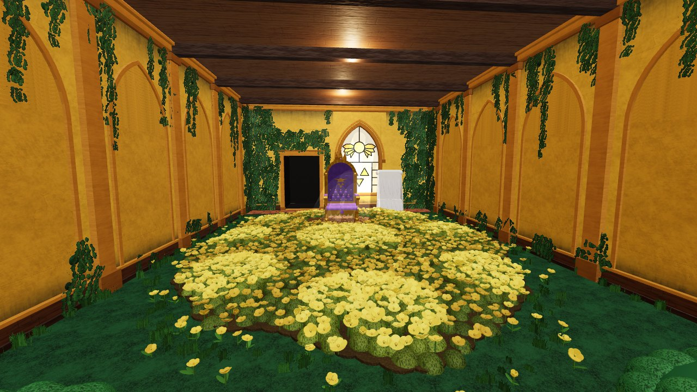
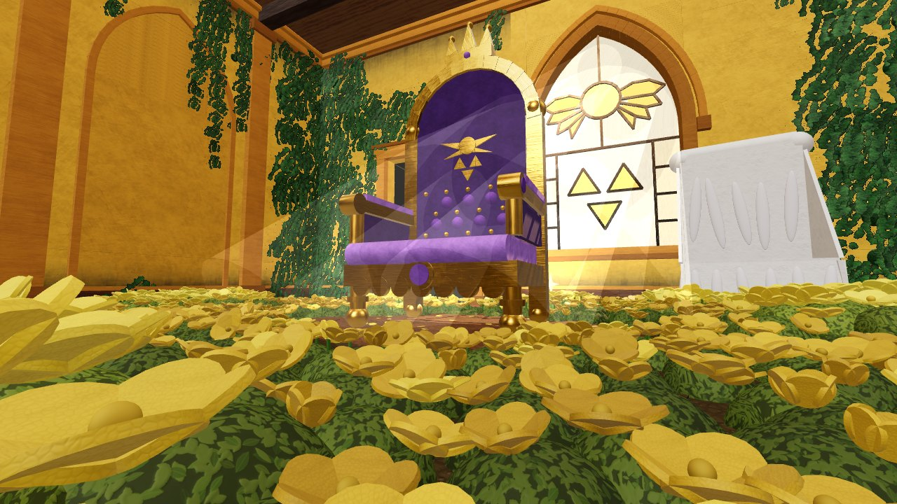
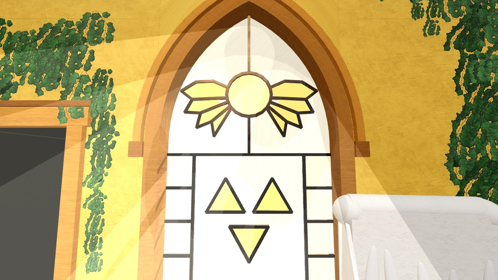
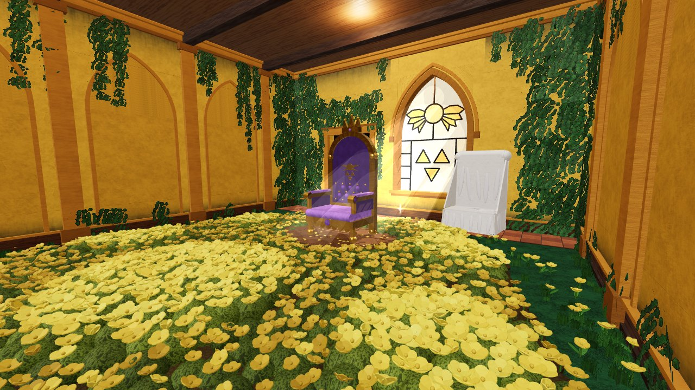
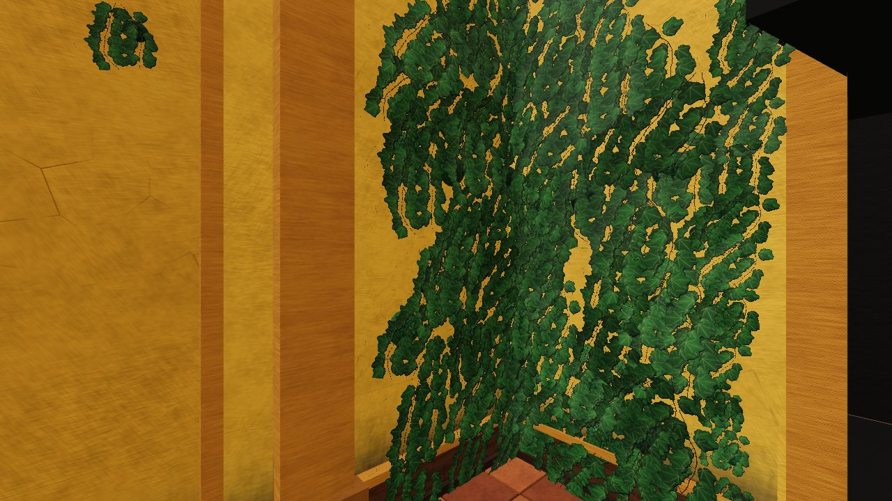
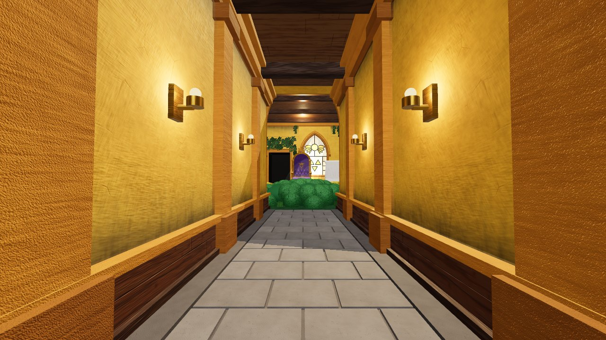

# Asgore's Throne Room (Undertale) for Roblox

A walk-in recreation of Asgore's throne room, built from Roblox parts, with its own set of
PBR textures. With the textures uploaded (see [Textures](#textures); until then it uses
Roblox's built-in materials), it has:

- **Golden flower bed.** About 2,400 satin-gloss buttercups on leafy mounds, with the
  bright raised clusters laid out as in the original room. Some are buds and some turn
  toward the light. A dirt clearing holds the throne.
- **Asgore's throne.** Tufted purple velvet in a brushed-gold frame, with an arched back,
  a crown crest, scrolled armrests and a small Delta Rune on the backrest.
- **The covered throne.** A second throne under a linen dust sheet, gold feet showing.
- **Stained-glass window.** A pointed-arch window with the Delta Rune (winged circle over
  three triangles) in amber glass. Its lead lines cast the pattern onto the floor.
- **Window light.** Spotlights behind the glass, soft light shafts and drifting dust. The
  sun is aimed through the window when the game starts.
- **Golden walls.** Plaster with pilasters, blind gothic arches, wood wainscot, cornices,
  a beamed plank ceiling and grime in the corners. Real-looking ivy covers the corners,
  hangs from the cornice and grows over the walls by the entrance.
- **Grass.** Terrain grass on the green floor, with tufts of tall grass along the walls,
  around the bushes and at the edge of the flower bed.
- **Doorway and corridor.** A dark doorway toward the barrier, and an entrance corridor
  with limestone slabs and wall lamps where you spawn.
- **Save point.** It spins and sparkles. Press **E** to save: an Undertale-style text box
  appears ("You are filled with DETERMINATION") and your health is restored.
- **Lighting.** Future lighting, warm ambient light, atmosphere haze, bloom and a colour
  grade.

## Previews

These show the room with every texture uploaded. They come from a quick three.js renderer
(`tools/preview`), not Roblox: the textures and layout are the real ones, but the lighting,
bloom and terrain grass are not Roblox's.

| | |
|---|---|
|  |  |
|  |  |
|  |  |

## Use it

**Open the place.** Open `dist/AsgoreThroneRoom.rbxl` in Roblox Studio (File → Open from
File) and press Play. You spawn in the corridor facing the room. This file uses Roblox's
built-in materials, because textures only show once they've been uploaded to Roblox (see
below). The terrain grass grows when you press Play.

**Add it to your own place.** Right-click Workspace → Insert from File →
`dist/AsgoreThroneRoom.rbxm`. When the game starts, the model's `ThroneRoomServer` script
applies the room's lighting and grows the grass. For the full look, set **Lighting →
Technology** to **Future** yourself, because scripts can't change it. If you want to keep
your own lighting, set the model's `ApplyLighting` attribute to false.

**Build it from the source.** Paste all of `src/ThroneRoomBuilder.luau` into Studio's
command bar and press Enter. It builds the room in Workspace, grows the terrain grass, sets
the lighting, aims the sun and frames the camera. This is the way to get the textures.

**Swaying grass.** Tick **Workspace → Terrain → Decoration** for animated grass blades.
The builder turns it on when you build from the command bar; a running game may not be
allowed to.

## Textures

`textures/` holds 13 tileable PBR sets (colour, normal and roughness maps, plus metalness
for gold) and four cut-outs:

| Set | Used for |
|---|---|
| `plaster`, `sandstone` | walls; pilasters, moldings and the window frame |
| `woodplanks`, `wood` | ceiling and wainscot panels; beams and skirting |
| `gold`, `velvet`, `linen` | the thrones and the dust sheet |
| `terracotta`, `limestone`, `soil` | floor tiles; corridor slabs; flower bed and clearing |
| `grass`, `leaves`, `petal` | green floor; foliage, bushes and ivy mounds; flower petals |
| `ivy_card`, `grass_card` | ivy sprigs on the walls; tufts of tall grass |
| `grime_card`, `glass_card` | dust above the wainscot and soot under the cornice; streaks in the window glass |

The colour maps are light and nearly neutral, because Roblox tints a MaterialVariant's
colour map with the part's Color. `tools/make_textures.py` regenerates them all (it needs
numpy and Pillow).

**Upload them once.** Roblox only shows images that are uploaded to it:

1. In the [Creator Dashboard](https://create.roblox.com/dashboard/credentials), create an
   Open Cloud API key with the **Assets** API's read and write permissions.
2. Run the upload script with your user id (or `--group-id` for a group):

   ```sh
   python3 tools/upload_textures.py --api-key YOUR_KEY --user-id YOUR_USER_ID
   ```

   It uploads the 44 images and writes their ids into the `TEXTURE_IDS` table at the top
   of `src/ThroneRoomBuilder.luau`. If it stops partway, run it again: it skips what's
   already uploaded.
3. Paste `src/ThroneRoomBuilder.luau` into Studio's command bar and press Enter.

Open Cloud uploads images as Decals. The script asks Roblox for the image inside each one,
and if your key can't do that it saves the decal id instead. The builder then looks the
image up itself when it runs in Studio.

**Or by hand.** Import the PNGs with Studio's Asset Manager (Bulk Import) and paste each
image's id into `TEXTURE_IDS`. Any texture left empty uses Roblox's built-in material, so
you can do just a few. The ivy cut-out (`ivy_card`) and `plaster_color` make the biggest
difference.

The builder makes the textured materials as MaterialVariants named `ThroneRoom_*` in
MaterialService. If you move the room to another place, copy those along with it.

## Settings

The settings are at the top of `src/ThroneRoomBuilder.luau`:

| Setting | Default | What it does |
|---|---|---|
| `Origin` | `CFrame.new(0, 0, 0)` | Where the room goes. The back wall's inside face is at the origin, and the room runs toward +Z. |
| `Seed` | `915` | Change it for a different flower and ivy layout. |
| `FlowerSpacing` | `1.45` | Raise it to `1.8` for about a third fewer flower parts on slower devices. |
| `ApplyLighting` | `true` | Whether the builder sets Lighting and the post effects. |
| `MusicId` | `""` | The numeric id of an audio asset you're allowed to use. It's stored as the model's `MusicId` attribute and played on loop. |
| `TerrainGrass` | `true` | Whether to grow terrain grass on the green floor. |

The lighting values are attributes on the model's `LightingPreset` folder, and the post
effects are its children. Change them there.

**Performance.** Flowers, ivy and other small details are anchored and don't collide,
take touches or cast shadows. Walls, floors and furniture do. With textures there are
about 21k parts, since ivy cut-outs replace most of the ivy mounds; without them, about
25k.

## Rebuild the files

The `.rbxl` and `.rbxm` files are made by running the builder in
[Lune](https://lune-org.github.io/docs) (`cargo install lune`). From the repository root:

```sh
lune run tools/build    # writes dist/AsgoreThroneRoom.rbxl and dist/AsgoreThroneRoom.rbxm
lune run tools/check    # builds the room and runs both game scripts against stand-ins
```

Once the texture ids are filled in, `lune run tools/build` puts them in the place file
too. `tools/check` validates every property the builder and the scripts set against
Roblox's API database. It also builds the room with every texture, and checks that the
save dialog opens and closes, that saving restores health, that the server grows the
grass and that the sun search lands on the window.

To redraw the previews, dump the parts as if every texture were uploaded, then render them
in headless Chromium:

```sh
lune run tools/build -- --preview
cd tools/preview
npm install && npx playwright install chromium
node shoot.js out entrance low winclose side ivy corridor top
```

The views are named in `tools/preview/render.html`, and `top` matches the framing of the
original top-down room.

## Not yet tested in Studio

These files haven't been opened in Roblox Studio, and the upload script hasn't been run
against Roblox: this was built where Roblox's servers can't be reached. Everything was
built and checked with Lune, and the upload script was run against a stand-in server.
Things to look at first:

- **Brightness.** If the room looks too dark or too bright, adjust `Brightness`,
  `Ambient` and `ExposureCompensation` on `LightingPreset`, or the brightness of the
  `CeilingFill` lights.
- **Texture scale.** Each set's `tile` (studs per copy of the texture) is in
  `MATERIAL_SETS` near the top of the builder, and on each MaterialVariant in
  MaterialService.
- **The sun.** The sun is aimed through the window when the game starts, or when you build
  from the command bar. In edit mode, a place opened from the `.rbxl` shows its stored
  time of day until you press Play. The window spotlights light the floor either way.
