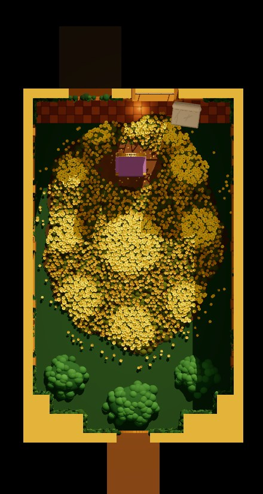

# Asgore's Throne Room (Undertale) for Roblox

A walk-in recreation of Asgore's throne room, built from about 25,000 Roblox parts. It has:

- **Golden flower bed.** About 2,400 five-petal flowers on leafy mounds, with the bright
  raised clusters laid out as in the original room. A dirt clearing holds the throne.
- **Asgore's throne.** Tufted purple velvet in a gold frame, with an arched back, a crown
  crest, scrolled armrests and a small Delta Rune on the backrest.
- **The covered throne.** A second throne under a dust sheet, gold feet showing.
- **Stained-glass window.** A pointed-arch window with the Delta Rune (winged circle over
  three triangles) in amber glass. Its lead lines cast the pattern onto the floor.
- **Window light.** Spotlights behind the glass, soft light shafts and drifting dust. The
  sun is aimed through the window when the game starts.
- **Golden walls.** Pilasters, blind gothic arches, wood wainscot, cornices and a beamed
  ceiling. Ivy covers the corners, hangs from the cornice and grows over the walls by the
  entrance.
- **Doorway and corridor.** A dark doorway toward the barrier, and an entrance corridor
  with stone slabs and wall lamps where you spawn.
- **Save point.** It spins and sparkles. Press **E** to save: an Undertale-style text box
  appears ("You are filled with DETERMINATION") and your health is restored.
- **Lighting.** Future lighting, warm ambient light, atmosphere haze, bloom and a colour
  grade.

## Previews

These previews come from a quick three.js renderer (`tools/preview`), not Roblox. They
have no Roblox materials, no Future lighting and no bloom, so they show the layout and
colours, not the final look.

| | |
|---|---|
|  |  |
|  |  |
|  |  |

## Use it

**Open the place.** Open `dist/AsgoreThroneRoom.rbxl` in Roblox Studio (File → Open from
File) and press Play. You spawn in the corridor facing the room.

**Add it to your own place.** Right-click Workspace → Insert from File →
`dist/AsgoreThroneRoom.rbxm`. When the game starts, the model's `ThroneRoomServer` script
applies the room's lighting. For the full look, set **Lighting → Technology** to
**Future** yourself, because scripts can't change it. If you want to keep your own
lighting, set the model's `ApplyLighting` attribute to false.

**Build it from the source.** Paste all of `src/ThroneRoomBuilder.luau` into Studio's
command bar and press Enter. It builds the room in Workspace, sets the lighting, aims the
sun and frames the camera. You can also put the file in a Script in ServerScriptService to
build the room at runtime, but the save point then won't spin or show its text box,
because a running game can't create scripts.

## Settings

The settings are at the top of `src/ThroneRoomBuilder.luau`:

| Setting | Default | What it does |
|---|---|---|
| `Origin` | `CFrame.new(0, 0, 0)` | Where the room goes. The back wall's inside face is at the origin, and the room runs toward +Z. |
| `Seed` | `915` | Change it for a different flower and ivy layout. |
| `FlowerSpacing` | `1.45` | Raise it to `1.8` for about a third fewer flower parts on slower devices. |
| `ApplyLighting` | `true` | Whether the builder sets Lighting and the post effects. |
| `MusicId` | `""` | The numeric id of an audio asset you're allowed to use. It's stored as the model's `MusicId` attribute and played on loop. |

The lighting values are attributes on the model's `LightingPreset` folder, and the post
effects are its children. Change them there.

**Performance.** Flowers, ivy and other small details are anchored and don't collide,
take touches or cast shadows. Walls, floors and furniture do. Most of the 25k parts are
flowers (about 15k) and ivy (about 7k).

## Rebuild the files

The `.rbxl` and `.rbxm` files are made by running the builder in
[Lune](https://lune-org.github.io/docs) (`cargo install lune`). From the repository root:

```sh
lune run tools/build    # writes dist/AsgoreThroneRoom.rbxl and dist/AsgoreThroneRoom.rbxm
lune run tools/check    # builds the room and runs both game scripts against stand-ins
```

`tools/check` validates every property the scripts set against Roblox's API database. It
also checks that the save dialog opens and closes, that saving restores health and that
the sun search lands on the window.

To redraw the previews, dump the parts and render them in headless Chromium:

```sh
lune run tools/build -- --parts tools/preview/parts.json
cd tools/preview
npm install && npx playwright install chromium
node shoot.js out entrance throne winclose side corridor top
```

The views are named in `tools/preview/render.html`, and `top` matches the framing of the
original top-down room.

## Not yet tested in Studio

These files haven't been opened in Roblox Studio yet. They were built and checked with
Lune only. Things to look at first:

- **Brightness.** If the room looks too dark or too bright, adjust `Brightness`,
  `Ambient` and `ExposureCompensation` on `LightingPreset`, or the brightness of the
  `CeilingFill` lights.
- **The sun.** The sun is aimed through the window when the game starts, or when you build
  from the command bar. In edit mode, a place opened from the `.rbxl` shows its stored
  time of day until you press Play. The window spotlights light the floor either way.
